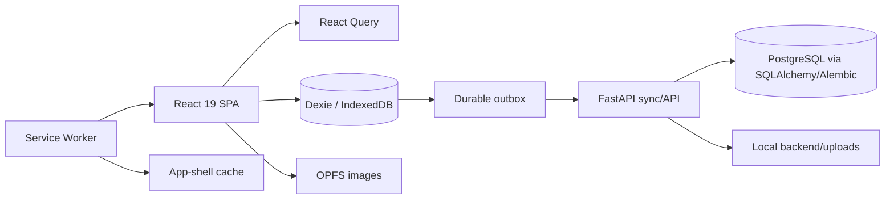
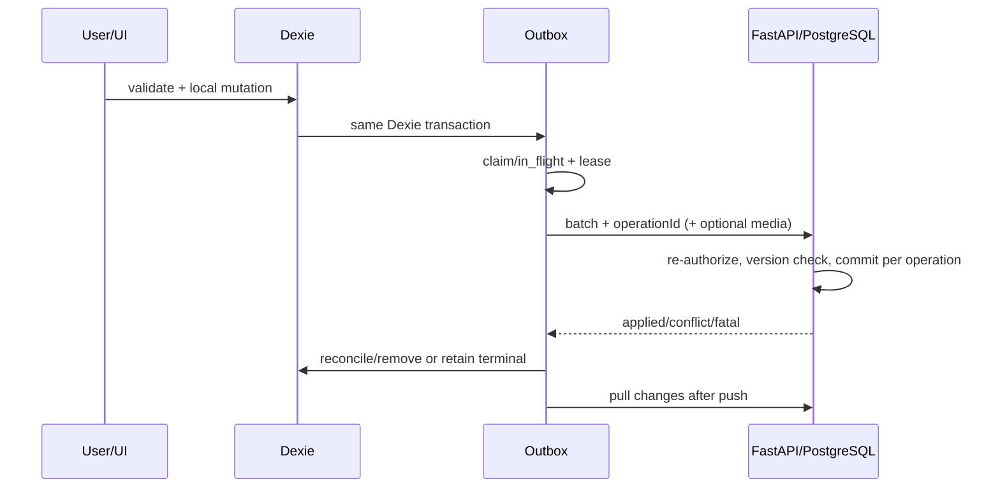

# ممیزی وضعیت فعلی Tanzim Commercial V1

تاریخ ممیزی: ۱۴۰۵/۰۷/۳۰ (2026-10-22، Asia/Tehran)  
نسخهٔ ممیزی‌شده: شاخهٔ `draft`، commit برابر `e719c7f1de63b35b28ac7123704fcee70f10ba54`

## ۱. خلاصهٔ مدیریتی

Tanzim در وضعیت فعلی یک SPA محلی‌اول با backend عملیاتی FastAPI است. محصول، همگام‌سازی، مدیریت پرسنل، نقش‌ها، اشتراک، بارکد، پشتیبان محلی و کاتالوگ مشترک همگی کد فعال دارند؛ بااین‌حال آمادگی تجاری V1 یکنواخت نیست. مدل مالکیت **ترکیبی و نیمه‌مهاجرت‌یافته** است: API در زمان اجرا داده را با فروشگاه و مالک آن مقید می‌کند، اما چند جدول اصلی و کلید idempotency هنوز بر `user_id` مالک قدیمی متکی‌اند. انتخاب صریح «عضویت فعال» نیز وجود ندارد و اولین عضویت، با اولویت مالک، انتخاب می‌شود.

مهم‌ترین مانع انتشار، ریسک از‌دست‌رفتن ویرایش جدید بعد از «ثبت موفق سرور + گم‌شدن پاسخ» است: outbox برای رکورد `retryable_error` همان `operationId` را نگه می‌دارد و ویرایش جدید را در همان رکورد compact می‌کند؛ سرور در تکرار، پاسخ ذخیره‌شدهٔ عملیات قبلی را برمی‌گرداند و کلاینت ممکن است payload جدید را تأییدشده تلقی و حذف کند (`SYNC-001`). این سناریو تست مستقیمی ندارد.

سیاست آفلاین فعلی با سیاست پیشنهادی تیمی سازگار نیست. مالک و پرسنل تیم، در صورت وجود entitlement کش‌شده (و برای پرسنل تا ۲۴ ساعت از آخرین تأیید)، همانند فروشگاه تک‌نفره تغییر محلی انجام می‌دهند و بعداً sync می‌کنند. در مقابل، سیاست پیشنهادی برای همهٔ اعضای فروشگاه تیمی پذیرش آنلاین سرور را قبل از mutation مشترک می‌خواهد.

رسانه و پشتیبان نیز محدودیت مهم دارند: تصویر پردازش‌شده، نه لزوماً بایت‌های فایل اصلی، ارسال می‌شود؛ دستگاه پاک فقط هنگام آنلاین بودن تصویر تأییدشدهٔ سرور را نمایش می‌دهد و آن را برای آفلاین در OPFS بازسازی نمی‌کند؛ «sync داده» از «sync رسانه» جدا نمایش داده نمی‌شود. پشتیبان واقعی، محلی و خارجی است و کنترل store/account و SHA-256 دارد، ولی رمزنگاری ندارد و restore سروری پیاده نشده است.

کنترل‌های امنیتی پایه مانند session دستگاه، مجوز سمت سرور، فایل محافظت‌شده، CORS و headerهای امنیتی وجود دارند. در عین حال bearer token هم در `localStorage` مرورگر و هم به‌صورت خام در جدول session سرور نگهداری می‌شود؛ CSP، rate limiting و محدودیت pixel/decompression تصویر مشاهده نشد. pipeline رسمی CI، monitoring، rollback و پشتیبان پایگاه‌داده/فایل سرور نیز در مخزن اثبات نشد.

## ۲. snapshot ممیزی و محدودیت‌ها

| مورد | نتیجه |
|---|---|
| شاخه/commit | `draft` / `e719c7f1de63b35b28ac7123704fcee70f10ba54` |
| وضعیت اولیهٔ worktree | پاک؛ `git status --short --branch` فقط `## draft` |
| دامنهٔ تغییر ممیزی | فقط همین گزارش و فایل JSON همراه؛ build/test artifactها در مسیرهای ignoreشده |
| محیط | Windows/PowerShell، Node `v24.12.0`، npm `10.8.1`، Python `3.13.13` |
| سرویس backend واقعی | راه‌اندازی نشد؛ تست‌های سریع با SQLite موقت اجرا شدند |
| PostgreSQL | Docker CLI `29.2.0` موجود، ولی daemon با `permission denied` غیرقابل دسترس؛ integration test اجرا نشد |
| مرورگر | Chromium Playwright روی build production و `vite preview`؛ desktop و Pixel 7 |

نواحی بررسی‌شده شامل `src/`، `backend/app/`، migrationها و testهای backend، `public/sw.js`، `tests/unit`، `tests/component`، `tests/e2e`، manifestها، lockfile، Docker configuration، `AGENTS.md` و `docs/store-personnel-architecture.md` بود. کد اجرایی و رفتار تست‌شده بر توضیحات و dependency نصب‌شده مقدم دانسته شد. برای نمونه، `keycloak-js` نصب است اما import فعالی ندارد؛ بنابراین ارائه‌دهندهٔ احراز هویت واقعی نیست.

محدودیت‌ها: PostgreSQL واقعی، دوربین و scanner فیزیکی، چاپگر، File System Access در مرورگرهای مختلف، قطع واقعی process در لحظه‌های بحرانی، storage quota، deployment production، پرداخت، CDN/object storage و دادهٔ مشتری بررسی عملی نشدند. هیچ پایگاه‌داده‌ای reset و هیچ دادهٔ واقعی mutate نشد.

## ۳. معماری واقعی

- Frontend: React `19.2.5`، TypeScript `~6.0.2`، Vite `8.0.16` (نسخهٔ resolve‌شده در build)، TanStack Router، React Query، TanStack Virtual، Radix Themes/Icons، Lucide، Tailwind، Zod و formهای کنترل‌شدهٔ سفارشی. `react-hook-form` نصب است ولی جریان فعال قابل استنادی با import یافت نشد.
- منبع حقیقت محلی: Dexie `4.4.4` با schema نسخهٔ ۱۰ برای projectionها، outbox، cursor/metadata، barcode و movement؛ OPFS برای بایت تصاویر.
- PWA: `public/sw.js` با cache app shell/chunkها، navigation fallback و پیام background-sync به clientهای باز. Service Worker خودش credential و outbox page-context ندارد؛ با بسته بودن برنامه sync مستقل انجام نمی‌دهد.
- Backend: FastAPI `0.141.1`، SQLAlchemy `2.0.52`، Alembic `1.19.1`، PostgreSQL `18.6` در compose؛ SQLite فقط fixture تست. queue worker، Redis یا Celery وجود ندارد.
- احراز هویت واقعی: JWT سفارشی HS256 + `UserSession` و fingerprint دستگاه؛ نه Keycloak.
- فایل: filesystem محلی `backend/uploads` و endpoint محافظت‌شده. CDN/object storage فعال مشاهده نشد.
- تست: Vitest، Testing Library، pytest و Playwright. `.github`/CI، monitoring اجرایی، deployment pipeline و rollback automation در مخزن یافت نشد؛ فقط health endpoint و migrationها وجود دارند.

منابع حقیقت عمده: PostgreSQL برای وضعیت تأییدشدهٔ سرور، Dexie برای نمای عملیاتی آفلاین هر actor/store، outbox برای درخواست‌های ارسال‌نشده، OPFS برای media محلی، و configuration مرکزی plan/permission برای authorization. frontend dashboard از projection محلی می‌خواند، نه endpoint dashboard backend.

## ۴. ماتریس وضعیت قابلیت/سیاست

| شناسه | قابلیت/سیاست | وضعیت | نتیجهٔ واقعی |
|---|---|---|---|
| `OWN-001` | مالکیت فروشگاهی | متناقض یا ناسازگار | context فروشگاه اعمال می‌شود، اما جدول‌ها/unique/queryهای کلیدی هنوز `user_id` مالک قدیمی دارند. |
| `OWN-002` | انتخاب workspace فعال | پیاده‌سازی جزئی | اولین membership با اولویت owner انتخاب می‌شود؛ selector و claim فعالِ سروری وجود ندارد. |
| `AUTH-001` | session و ابطال دستگاه | پیاده‌سازی‌شده و runtime-verified | token، fingerprint و active session در هر درخواست کنترل می‌شوند؛ تست‌های backend موفق‌اند. |
| `AUTH-002` | پرسنل/نقش owner-only | پیاده‌سازی‌شده و runtime-verified | API آنلاین، ظرفیت و permission dependency کنترل می‌شوند؛ testهای backend/component موفق‌اند. |
| `OFF-001` | authorization آفلاین | پیاده‌سازی جزئی | owner از cache و personnel تا ۲۴ ساعت استفاده می‌کنند؛ لغو مجوز فوری روی دستگاه disconnected ممکن نیست. |
| `SYNC-001` | idempotency بعد از lost response | متناقض یا ناسازگار | reuse شدن operation ID همراه payload جدید می‌تواند ویرایش تازه را بی‌اثر و حذف کند. |
| `SYNC-002` | local atomic commit/outbox | پیاده‌سازی‌شده و runtime-verified | رکورد و queue در Dexie transaction مشترک نوشته می‌شوند. |
| `SYNC-003` | conflict/rejected recovery | پیاده‌سازی جزئی | conflict/fatal/dead-letter حفظ و نمایش می‌شوند؛ merge خودکار quantity وجود ندارد. |
| `MED-001` | lifecycle تصویر | پیاده‌سازی جزئی | resize/compress، OPFS، upload و فایل محافظت‌شده فعال است؛ rehydration و media status مستقل نیست. |
| `BAK-001` | پشتیبان خارجی محلی | پیاده‌سازی‌شده و runtime-verified | snapshot، media محلی، hash، ownership check و fallback وجود دارد؛ unit/component/E2E پوشش دارند. |
| `BAK-002` | restore/backup سرور | پیاده‌سازی‌نشده | endpoint restore سرور `501` است و procedure عملیاتی DB/files وجود ندارد. |
| `CAT-001` | کاتالوگ مشترک بر مبنای فروشگاه | متناقض یا ناسازگار | reconcile با `User.industry_id` و ساخت item برای user انجام می‌شود، نه membership/store. |
| `FEAT-001` | قابلیت‌های عملیاتی V1 | پیاده‌سازی جزئی | CRUD، سه نما، import/export، barcode/print و responsive فعال‌اند؛ سخت‌افزار و برخی semantics تأیید نشده‌اند. |
| `DASH-001` | dashboard/مالی | متناقض یا ناسازگار | محاسبات «ارزش بالقوه» محلی‌اند؛ transaction فروش/درآمد واقعی وجود ندارد و backend population متفاوت است. |
| `SUB-001` | اشتراک تجاری | پیاده‌سازی جزئی | enforcement ظرفیت/قابلیت فعال است؛ پرداخت/تمدید، quota رسانه و support tier وجود ندارد. |
| `SEC-001` | امنیت کاربردی | پیاده‌سازی جزئی | authorization و protected files قوی‌تر شده‌اند؛ token خام، نبود CSP/rate limit و image bomb limits باقی است. |
| `OPS-001` | آمادگی عملیات production | فقط مستند/پیکربندی یا فاقد شاهد | migration/health موجود؛ CI، monitoring، backup server و rollback اثبات نشد. |

جزئیات inventory و integration قابلیت‌ها:

| قابلیت | عملکرد واقعی/آفلاین | مجوز و شکاف مهم |
|---|---|---|
| CRUD محصول و تغییر سریع تعداد | local-first؛ projection و outbox اتمیک و sync زمان‌بندی می‌شود. | `inventory.write`؛ تغییر سریع ظاهراً delta است ولی sync مقدار مطلق می‌فرستد. |
| سه نمای کارت | comfortable، compact/list و grid فعال؛ virtualizer در نماهای غیر-grid به‌کار می‌رود. | E2E برای اطلاعات اصلی، اندازهٔ بزرگ و keyboard viewport موفق بود. |
| جست‌وجو/مرتب‌سازی/filter | نام، برچسب سفارشی، label و barcode؛ newest/oldest/price/quantity. | multi-label با منطق ANY (`some`) است، نه AND؛ این انتخاب محصولی باید صریح باشد. |
| bulk select/edit/delete | انتخاب طولانی، action bar و تغییر گروهی فعال و local-first است. | `bulk.edit` و write؛ delete محصول catalog-backed محدود/به hide تبدیل می‌شود. |
| دسته و برچسب | CRUD محلی‌اول و sync؛ اتصال label به محصول فعال. | ownership هنوز legacy owner-user + store ثانویه است. |
| Excel import/template | parser واقعی OOXML با `@office-kit/xlsx`؛ فقط `.xlsx` و template واقعی تولید می‌شود. | `import.xlsx`؛ quantity مطلق و success اولیه محلی است. |
| CSV/Excel/PDF export | CSV واقعی؛ Excel یک جدول HTML سازگار با Excel با پسوند صادقانهٔ `.xls`؛ PDF از print dialog مرورگر است، نه PDF generator. | export local/server capability؛ خروجی سرور فقط CSV/JSON snapshot را پوشش می‌دهد. |
| clipboard | Clipboard API با fallback `execCommand`؛ متن محصول را کپی می‌کند. | وابسته به permission browser؛ انتقال ساختاری یا share service بیرونی نیست. |
| barcode | تخصیص، تولید داخلی، lookup، movement و correction/reversal فعال. | `barcode.lookup/manage`؛ uniqueness store-based برای barcode و idempotency movement وجود دارد. |
| camera/hardware scanner | `BarcodeDetector` بومی و fallback ZXing؛ hardware scanner با buffer ورودی keyboard. | دوربین/دستگاه واقعی runtime-verified نشد؛ نیازمند permission/secure context است. |
| label/print | HTML/CSS label با Vazirmatn و barcode تولید، سپس browser print. | `label.print`؛ printer language/driver مستقیم ندارد و چاپگر واقعی تست نشد. |
| navigation/settings/tools/management | routeها و guardها فعال؛ management برای platform admin، personnel/roles برای owner. | direct route هم در client و هم API کنترل می‌شود؛ E2E responsive موفق است. |
| Help/FAQ/notifications | handbook موضوعی و notificationهای sync/backup/update فعال‌اند. | برخی پیام‌ها وضعیت local success را از server acceptance به‌اندازهٔ کافی برجسته نمی‌کنند. |
| ظاهر/فونت/اندازه | light/dark/system، Vazirmatn و سه display preset قبل از render اعمال می‌شوند. | یک شکست theme desktop در rerun عبور کرد؛ نیازمند پایدارسازی تست است. |
| Jalali | formatter/input/export تاریخ جلالی در utilityها و فرم‌های مربوط فعال است. | پوشش unit موفق؛ timezone و مرورگرهای غیرChromium به‌صورت جامع بررسی نشد. |
| responsive/fixed navigation | inset مشترک، mobile bottom nav، desktop nav و keyboard/virtualizer layout تست شده‌اند. | scroll restoration داشبورد در هر دو viewport به‌طور پایدار شکست خورد. |

## ۵. رفتار آنلاین/آفلاین برحسب سناریوی کاربر

| سناریو | خواندن/تغییر/صف | reconnect و پیام UI |
|---|---|
| فروشگاه تک‌نفره | projection محلی خوانده می‌شود؛ mutation ابتدا در Dexie و outbox ثبت و فوراً موفقیت محلی نشان داده می‌شود. | sync زمان‌بندی می‌شود؛ conflict/rejection در صفحهٔ recovery و status نمایش داده می‌شود. |
| مالک فروشگاه چندنفره | عملاً همان رفتار تک‌نفره است؛ «تیمی بودن» local mutation را online-only نمی‌کند. | سرور هنگام پذیرش دوباره authorization می‌کند؛ ممکن است تغییر قبلاً موفق‌نمایش‌داده‌شده رد شود. |
| پرسنل فروشگاه | با snapshot entitlement و مجوز cacheشده تا سقف lease ۲۴ ساعت می‌تواند بخواند/تغییر دهد؛ temporary password مسیر عملیاتی را می‌بندد. | permission/subscription فعلی در acceptance کنترل؛ عملیات ردشده terminal و قابل بازیابی می‌ماند. |
| چند دستگاه یک هویت | هر profile، Dexie/OPFS مستقل دارد؛ server change feed همگرا می‌کند. absolute quantity با version conflict محافظت می‌شود، نه merge. | pull پس از push؛ conflict نیازمند تصمیم کاربر است. |
| اولین login دستگاه جدید | login آنلاین، device admission و session لازم است؛ cache اولیه ندارد. | بعد از دریافت projection می‌تواند آفلاین شود؛ media سرور فقط online resolve می‌شود. |
| backend قطع ولی browser online | network `TypeError` به snapshot آفلاین fallback می‌کند؛ mutation محلی ممکن است پذیرفته شود. | status خطا/در انتظار؛ queue حفظ و بعداً retry می‌شود. |
| authentication منقضی در حالت آفلاین | client عمدتاً وجود token و entitlement cache را می‌بیند؛ امکان ادامه تا حدود cache/lease هست. | اولین `401/403` token را پاک/وضعیت را اصلاح می‌کند؛ queue به pending برمی‌گردد و حذف نمی‌شود. |

UI موفقیت اولیه را عمدتاً موفقیت ذخیرهٔ محلی می‌داند، نه پذیرش قطعی سرور. این تمایز در status/recovery قابل مشاهده است، اما برای کاربر عادی همیشه هم‌معنای «درخواست در انتظار پذیرش» را برجسته نمی‌کند.

## ۶. مالکیت، پرسنل و کنترل دسترسی

Signup، user، store و owner membership را با هم می‌سازد؛ بنابراین توزیع‌کننده می‌تواند بدون افزودن پرسنل به‌صورت فروشگاه مستقل تک‌نفره کار کند. `Store.owner_user_id` یکتا و `StoreMembership(store_id,user_id)` یکتا است. platform admin مسیر و workspace مدیریتی جدا دارد و بررسی کد، دسترسی ضمنی به store مشتری از صرف admin بودن نشان نداد.

بااین‌حال `Category`، `Label`، `InventoryItem`، `CustomProduct`، `SyncOperation`، `SyncChange` و transactionها همچنان `user_id` را مرز اصلی نگه می‌دارند؛ `store_id` در بخش‌هایی nullable یا ثانویه است. API با `current_user.data_owner_id = store.owner_user_id` این بدهی را پنهان می‌کند. unique محصول کاتالوگی نیز `(user_id, catalog_product_id)` است. این الگو فعلاً اشتراک owner/personnel را ممکن می‌کند، ولی مدل store-native کامل نیست و توسعهٔ multi-store را پرریسک می‌کند.

`active_store_context()` membership را با ترتیب owner-first/id انتخاب می‌کند؛ انتخاب صریح workspace فعال یا binding به claim session ندارد. client state با actor+store partition شده و هنگام تغییر account، React Query پاک می‌شود؛ اما هر actor برای همان store projection مستقل دارد.

پرسنل و role administration آنلاین و owner-only است؛ به outbox عملیاتی نمی‌رود. رمز موقت با generator امن ساخته و فقط یک بار به owner برگردانده می‌شود، hash بلافاصله ذخیره می‌شود و تا تغییر رمز، access boundary/API عملیات را محدود می‌کند. role dependency و unknown permission deny در backend انجام می‌شود. اولویت مؤثر تقریباً platform-admin bypass در workspace خودش، سپس store subscription/domain، role permissions و override کاربر است. جزئیات قیمت خرید/فروش در projection سرور برحسب permission حذف می‌شود؛ اما داده‌ای که پیش از لغو مجوز در cache دستگاه بوده، در زمان offline قابل پاک‌سازی فوری نیست.

یافتهٔ خاص کاتالوگ: `_reconcile_catalog_assignments()` کاربران دارای `User.industry_id` را انتخاب و برای هر user `InventoryItem(user_id=user.id)` می‌سازد. `attach_store_context()` نیز industry پرسنل را با مالک همسان می‌کند. این جریان با invariant مالکیت فروشگاهی ناسازگار و مستعد row جداگانه برای پرسنل است (`backend/app/services/catalog_product_service.py:42-75`، `backend/app/services/store_service.py:114-133`).

سیاست‌های فعال کاتالوگ و inventory:

- محصول shared را platform admin در `CatalogProduct` و برای یک industry می‌سازد؛ archive/restore/permanent delete تراکنشی و همراه change/tombstone است. فایل shared روی همان رکورد کاتالوگ می‌ماند.
- محصول خصوصی کاربر نیز به‌دلیل FK اجباری، یک `CatalogProduct` خصوصی پشت `InventoryItem` دارد؛ بنابراین «custom product» کاملاً مستقل از catalog table نیست.
- provisioning با تغییر domain، محصولات industry جدید را ایجاد/نمایان و موارد نامرتبط را پنهان می‌کند؛ به‌علت user-based reconcile، مرز store کامل نیست.
- کاربر محصول catalog-backed را حذف دائمی نمی‌کند؛ می‌تواند آن را hide کند. inactive/archive کاتالوگ از فهرست eligible حذف می‌شود.
- فیلدهای package/unit و metadata اصلی محصول shared مرکزی‌اند؛ فرم برای بخش‌های کنترل‌شده read-only است. quantity و قیمت‌های store-specific روی inventory قرار می‌گیرند.
- `purchase_price` و `sale_price` جدا و nullable هستند؛ legacy `price` برای سازگاری وجود دارد. `null` با صفر فرق دارد و `price_missing` آن را به UI منتقل می‌کند. quantity نامعلوم مدل نشده؛ quantity عدد غیرمنفی است و صفر معنای موجودی صفر دارد.
- تبدیل بسته/واحد در helper مرکزی انجام می‌شود و stock همواره مقدار پایهٔ عددی نگه می‌دارد. exportها همان projection و metadata package را مصرف می‌کنند.
- ظرفیت plan بر تعداد `InventoryItem` اعمال می‌شود؛ سقف مستقل برای تعداد محصولات shared catalog مشاهده نشد.

## ۷. همگام‌سازی و تمامیت موجودی

جریان فعال چنین است:

local write و outbox برای product/category/label/barcode/movement در یک Dexie transaction هستند (`local-mutation-storage.ts:38-73`). OPFS داخل این transaction نیست. startup، `in_flight` منقضی را recovery می‌کند؛ claim با compare-and-set و lease ۶۰ثانیه‌ای انجام می‌شود؛ `navigator.locks` از workerهای هم‌پوشان tabها جلوگیری می‌کند. retry با jitter/backoff تا ۵ دقیقه و سقف پنج تلاش است و سپس dead-letter می‌شود.

batch سرور حداکثر ۲۰۰ عملیات را می‌پذیرد و هر عملیات را جدا commit می‌کند؛ پس partial success عمدی است. هر عملیات در لحظهٔ acceptance دوباره authorize می‌شود. نتیجهٔ rejected در `SyncOperation` و activity ثبت و در client به‌صورت fatal terminal حفظ می‌شود. operation ID، dedup سرور، tombstone و pull cursor فعال‌اند. pull حداکثر ۵۰۰ change می‌گیرد. عملیات delete و archive کاتالوگ tombstone/change منتشر می‌کنند.

ریسک blocker `SYNC-001`: در `queue.service.ts:77-132` رکورد pending/retryable برای همان entity compact و `pending.operationId` حفظ می‌شود. در `sync.py:693-706` سرور نتیجهٔ operation ID قبلی را deduplicate می‌کند. اگر commit سرور موفق و پاسخ گم شود، سپس کاربر پیش از retry ویرایش دیگری انجام دهد، payload تازه زیر همان ID می‌رود؛ retry پاسخ قدیمی می‌گیرد و client می‌تواند رکورد تازه را حذف کند. راه امن حداقلی، freeze payload هویت‌دار یا تخصیص ID تازه به mutation پس از هر attempt با outcome نامعلوم، همراه آزمون regression است.

quantity یک مدل واحد ندارد:

- form ثبت/ویرایش، کنترل سریع، bulk edit و import در نهایت مقدار **مطلق** `quantity` را با `base_version` ارسال می‌کنند. کنترل سریع ابتدا delta را روی snapshot محلی اعمال می‌کند، اما payload sync مطلق است.
- barcode inventory movement، **افزایشی/کاهشی** است و correction/reversal idempotent دارد؛ server row lock، stale correction و insufficient stock را کنترل می‌کند.
- تغییر مطلق سرور از اختلاف before/after، `InventoryTransaction` می‌سازد. این transaction فروش نیست.

در multi-device، absolute updateهای هم‌زمان با version conflict متوقف می‌شوند ولی merge خودکار ندارند. category versioning هم‌سطح product/label/barcode دیده نشد. Background Sync صرفاً client باز را بیدار می‌کند و تضمین اجرای بسته‌شده ندارد.

## ۸. تصاویر و رسانهٔ کاتالوگ

تصویر محصول در browser decode و حداکثر `1280×1280` می‌شود، با budget حدود ۲٫۵MB به WebP فشرده می‌شود؛ WebP/AVIF مناسب ممکن است passthrough شود. blob در OPFS زیر namespace `inventory-images` قرار می‌گیرد و metadata `local://...` در Dexie است. server MIMEهای JPEG/PNG/WebP/AVIF/GIF و سقف ۱۰MB را کنترل، نام تصادفی تولید و فایل قبلی `/uploads/` را هنگام جایگزینی حذف می‌کند. pixel count/decompression-bomb validation دیده نشد.

پاسخ صریح به پرسش‌های چرخهٔ رسانه:

1. **آیا بایت اصلی ارسال می‌شود؟** همیشه نه؛ معمولاً blob پردازش/resize/compress‌شده ارسال می‌شود، و فقط passthrough ممکن است همان بایت ورودی باشد.
2. **آیا دستگاه پاک همهٔ تصاویر تأییدشده را بازیابی می‌کند؟** هنگام آنلاین بودن، بله برای نمایش از endpoint محافظت‌شده؛ rehydrate به OPFS و آمادگی کامل offline پیاده نشده است.
3. **فایل کاتالوگ shared است؟** بله، URL فیزیکی روی `CatalogProduct` مشترک است و per-store تکثیر نمی‌شود؛ access تنها با inventory مجاز کنترل می‌شود.
4. **آیا upload قدیمی انتخاب جدید را overwrite می‌کند؟** version conflict بین operationهای مستقل مانع معمول است؛ ولی ریسک stale acknowledgement در `SYNC-001` می‌تواند انتخاب جدید را گم کند.
5. **نبود media محلی remote delete می‌کند؟** خیر؛ client فایل گمشده را نادیده می‌گیرد و payload record را می‌فرستد. delete صریح فقط با `image_url=null` است.
6. **data sync از media sync جداست؟** خیر؛ اگر OPFS read شکست بخورد، record می‌تواند applied شود و status جداگانهٔ media وجود ندارد.
7. **شکست OPFS/IndexedDB وسط عملیات؟** write ناقص OPFS پاک می‌شود؛ metadata/outbox Dexie atomic است، اما OPFS در transaction نیست. orphan cleanup در startup وجود دارد؛ انتخاب تصویر بدون submit نیز می‌تواند تا cleanup orphan بسازد.

فایل server از `/api/files/{filename}` با تطبیق نام و inventory قابل دسترس تحویل می‌شود. service worker `/api` و `/uploads` را offline cache نمی‌کند. integrity hash، dedup محتوایی و garbage collector سراسری server دیده نشد. backup فقط بایت‌های OPFS محلی را می‌گیرد، نه همهٔ remote uploadها.

## ۹. پشتیبان و بازیابی

پشتیبان local external برای owner/admin فعال است: محصولات، دسته‌ها، برچسب‌ها، barcodeها، movementها، outbox، metadata منتخب، preferenceها و media موجود OPFS snapshot می‌شوند. envelope دارای format/schema version و SHA-256 است؛ schema نسخهٔ ۲ به بعد owner/store binding دارد و credentials، token، membership، role و subscription را شامل نمی‌شود. SHA-256 صحت تصادفی را می‌سنجد، نه اصالت را؛ رمزنگاری/امضای کلیددار وجود ندارد.

در مرورگر پشتیبان خودکار از File System Access و handle ذخیره‌شده در IndexedDB استفاده می‌کند و permission را query/request می‌کند؛ fallback، share/download دستی است. directory mode ابتدا pending file و بررسی اندازه دارد و نسخهٔ قبلی را نگه می‌دارد؛ single-file mode نسخهٔ قبلی جدا ندارد. dirty revision بر رکورد/path تکیه دارد، نه hash همهٔ بایت‌ها.

restore قبل از اعمال، recovery copy خارجی تحویل می‌دهد؛ media را پیش از transaction Dexie restore می‌کند، پس شکست DB می‌تواند orphan باقی بگذارد. رکوردهای بازیابی‌شدهٔ outbox با ID جدید و `RESTORED_BACKUP_REVIEW_REQUIRED` quarantine و sync pause می‌شوند. resume آن queueها را replay نمی‌کند؛ حذف می‌کند و server pull/reconciliation را مبنا می‌گیرد. بنابراین mutationهای صرفاً pending در backup، خودکار به سرور اعمال نمی‌شوند.

نقص store-future: پاک‌سازی queue موجود در restore بر `ownerUserId` تکیه دارد و در صورت فعال شدن multi-store ممکن است queueهای store دیگر همان actor را هم بزند. در وضعیت فعلی selector multi-store نداریم. backend فقط snapshot فعلی inventory را می‌دهد و restore endpoint صراحتاً `501` است؛ procedure نسخه‌دار backup/restore برای PostgreSQL و `backend/uploads`، retention و disaster-recovery در مخزن وجود ندارد.

## ۱۰. صحت داشبورد و مفاهیم مالی

داشبورد UI از Dexie محلی استفاده می‌کند. population اصلی، رکوردهای حذف‌نشده با نام معتبر و catalog فعال است؛ hidden catalog بسته به preference حذف می‌شود. ارزش موجودی از `quantity × sale_price` (یا legacy price) ساخته می‌شود و موارد قیمت نامعلوم از جمع حذف می‌شوند. بالاترین ارزش محصول/دسته از همین projection محاسبه می‌شود؛ «بدون دسته» از chart دسته کنار گذاشته و جدا اعلام می‌شود.

`Today’s Actions` شمارش event امروز نیست؛ فهرست وضعیت‌های قابل اقدام مانند ناموجود، کمبود، قیمت نامعلوم، طبقه‌بندی و خطای sync است. «افزوده‌شده امروز» با timezone محلی از `created_at` محاسبه می‌شود. history فعالیت سرور owner-only وجود دارد.

صفحهٔ مالی:

- ارزش خرید = مجموع `quantity × purchase_price` برای ردیف‌های دارای قیمت معتبر؛
- ارزش فروش = مجموع `quantity × sale_price`؛
- سود ناخالص بالقوه = مجموع `quantity × (sale - purchase)` روی پوشش معتبر؛
- حاشیه = سود بالقوه تقسیم بر ارزش فروش eligible؛
- missing-price coverage جدا گزارش می‌شود.

فروش، سفارش خرید، درآمد وصول‌شده یا COGS واقعی وجود ندارد؛ `InventoryTransaction` فقط تغییر stock است. بنابراین این مقادیر باید «ارزش/سود بالقوهٔ موجودی» بمانند و نباید درآمد یا سود محقق‌شده نامیده شوند. endpoint dashboard backend semantics ساده‌تر و population متفاوت (از جمله hidden) دارد؛ هرچند UI فعلی از آن استفاده نمی‌کند، وجود دو تعریف ناسازگار است. شکست پایدار E2E در scroll restoration داشبورد نیز ثبت شد (`TEST-001`).

## ۱۱. آمادگی اشتراک و تجاری‌سازی

طرح‌های built-in در `backend/app/plans.py:19-69`:

| طرح | سقف inventory | دستگاه | پرسنل | backup | قیمت ثبت‌شده |
|---|---:|---:|---:|---|---|
| free | 50 | نامحدود | 0 | خیر | 0 IRR |
| starter | 500 | نامحدود | 0 | بله | `null` |
| pro | 5000 | نامحدود | 0 | بله | `null` |
| vip | نامحدود | نامحدود | 10 | بله | `null` |

capabilityهای مرکزی شامل inventory read/write، category/label، import/export، backup، bulk، personnel، barcode lookup/manage و label print است. expiry فقط `inventory.read` را نگه می‌دارد. store override و user device override وجود دارد؛ domain tool policy جدا اعمال می‌شود.

تناقض admin UI: `PLAN_FEATURE_OPTIONS` فقط ۹ feature و `PLAN_LIMIT_OPTIONS` فقط inventory/device را قابل ویرایش نشان می‌دهد؛ `personnel`، barcodeها، label print و `active_personnel` پنهان‌اند. مقدارهای ناشناختهٔ قبلی با spread حفظ می‌شوند، اما admin نمی‌تواند همهٔ سیاست مؤثر را ببیند/ویرایش کند. media/storage quota، history availability، domain restriction در plan، support differentiation، payment و renewal service پیاده نشده‌اند؛ UI نیز پرداخت را غیرفعال معرفی می‌کند. pricing غیررایگان نهایی نیست.

## ۱۲. امنیت و حریم خصوصی

کنترل‌های اثبات‌شده: context سرور از membership می‌آید، client `store_id`/role را منبع اعتماد نمی‌کند؛ unknown permission رد می‌شود؛ هر sync در acceptance authorize می‌شود؛ فایل خصوصی با inventory/store scope کنترل می‌شود؛ bcrypt و محدودیت ۷۲بایت رمز، JWT expiry، active session/fingerprint، ابطال sessionهای دیگر بعد از تغییر رمز، CORS configured و headerهای `nosniff`، `DENY`، Referrer و Permissions Policy فعال‌اند. activity attribution با actor/membership سرور انجام و فیلدهای حساس sanitize می‌شود.

ریسک‌ها/شواهد غایب:

- `access_token` در `localStorage` و همان bearer token خام در `UserSession.access_token` ذخیره می‌شود؛ XSS یا افشای DB اثر بیشتری دارد.
- Content-Security-Policy و rate limiting برای login/API یافت نشد.
- upload فقط MIME/اندازه را می‌سنجد؛ pixel/decompression limit یا malware scanning ندارد.
- HTTPS/HSTS در برنامه اثبات نشد و به reverse proxy/deployment واگذار شده است.
- retention رسمی log/upload، key rotation، secret manager، alerting و audit export مشاهده نشد.
- Docker volume تنها شاهد durability PostgreSQL است؛ replication/backup و durability فایل upload اثبات نشد.

این ممیزی penetration test یا گواهی امنیتی نیست.

## ۱۳. نتایج آزمون‌ها

| فرمان | نتیجه |
|---|---|
| `npm.cmd test` | موفق: 69 فایل، 265 تست |
| `npm.cmd run test:typecheck` | موفق |
| `npm.cmd run lint` | موفق |
| `npm.cmd run build` | موفق؛ هشدار chunkهای بزرگ‌تر از 500kB |
| `.\.venv\Scripts\python.exe -m pytest -c backend\pytest.ini backend\tests --ignore=backend\tests\test_postgresql.py` | موفق: 42 تست |
| Playwright کامل روی build production، 2 project، `--workers=1` | 70 موفق، 4 ناموفق، 2 skipped از 76 |
| Playwright `--last-failed` | 2 موفق، 2 ناموفق؛ scroll restoration در هر دو project دوباره شکست خورد |
| `docker info` | client موجود؛ daemon با permission denied، پس PostgreSQL integration اجرا نشد |

دو skip مربوط به journey احراز هویت‌اند که test فقط با opt-in/backend مناسب اجرا می‌کند. شکست PWA cold-offline desktop و theme scaling desktop در rerun موفق شدند و flaky/نامطمئن‌اند. شکست `dashboard.spec.ts:50-62` در desktop و mobile پایدار ماند: پس از back، `scrollTop` صفر بود.

پوشش سناریوهای اولویت‌دار:

1. ماندگاری IndexedDB پس از restart profile در Playwright گذشت؛ termination دقیق بین local commit و schedule مستقلاً تزریق نشد.
2. server commit + lost response تست نشده و با inspection ریسک blocker کشف شد.
3. conflict/version و movement backend/unit پوشش جزئی دارند؛ multi-device هم‌زمان واقعی اجرا نشد.
4. authorization-at-acceptance در backend تست/کد پوشش دارد؛ browser E2E لغو مجوز حین قطع شبکه اجرا نشد.
5. profileهای پاک/مجزا تست شدند؛ recovery کامل media از سرور تست نشد.
6. old-backup/quarantine/reconciliation در unit تست شد؛ filesystem/browser matrix و server restore وجود ندارد.
7. account transition در unit و profile isolation در E2E پوشش دارد؛ multi-store switching قابل تست نیست چون feature وجود ندارد.
8. missing-image path از روی کد/تست‌های media پوشش جزئی دارد؛ قطع واقعی multipart وسط انتقال آزمایش نشد.

## ۱۴. ریسک‌ها و تناقض‌های رتبه‌بندی‌شده

### مانع انتشار

1. `SYNC-001` — reuse شدن operation ID بعد از outcome نامعلوم می‌تواند ویرایش جدید را بی‌صدا از دست بدهد. اثر: تمامیت داده و اعتماد کاربر؛ شاهد: `queue.service.ts:77-132` و `sync.py:693-706`.
2. `OWN-001/CAT-001` — مدل store و legacy user ownership مخلوط، به‌ویژه reconcile کاتالوگ بر userهای industry. اثر: ردیف اضافی/مرز مالکیت مبهم در تیم و مانع multi-store.

### مهم پیش از rollout گسترده‌تر

3. `MED-001` — applied شدن داده بدون انتقال media و نبود status/retry مستقل؛ دستگاه تازه offline media کامل ندارد.
4. `SEC-001` — bearer خام در localStorage و DB، نبود rate limit/CSP و upload pixel limits.
5. `BAK-002/OPS-001` — نبود backup/restore عملیاتی server و durability روشن فایل‌ها.
6. `OFF-001` — policy فعلی تیم local-first است و لغو permission تا reconnect/lease اثر قطعی ندارد.
7. `SUB-001` — admin editor همهٔ capability/limitهای مؤثر را نشان نمی‌دهد؛ commercial policy ناقص است.
8. `TEST-001` — scroll restoration dashboard پایدار شکست می‌خورد؛ دو مورد دیگر E2E flaky بودند.

### قابل تعویق پس از V1

9. یکنواخت‌سازی semantics endpoint dashboard غیرفعال با selector UI.
10. hash/dedup/GC پیشرفتهٔ رسانه، اگر ابتدا media-state صریح و backup server حل شود.
11. بهینه‌سازی chunkهای بزرگ، مادامی که performance budget و telemetry تعریف شود.

## ۱۵. مقایسه با سیاست پیشنهادی تک‌نفره/تیمی

| بند پیشنهادی | وضعیت فعلی | شکاف لازم |
|---|---|---|
| تک‌نفره local mutation و sync بعدی | سازگار | فقط رفع idempotency و شفاف‌سازی pending. |
| تیم فقط view آفلاین و mutation پس از پذیرش سرور | ناسازگار | server-derived team mode در entitlement؛ جلوگیری از commit/outbox mutation مشترک هنگام عدم پذیرش؛ UX خطا/درخواست. |
| سیاست تیم برای owner و personnel | ناسازگار | guard باید بر store mode باشد، نه role؛ owner استثنا نشود. |
| outcome نامعلوم durable بماند | جزئی/پرریسک | payload attempted را immutable نگه دارد؛ operation جدید برای edit تازه؛ state صریح unknown. |
| draft آفلاین، نه mutation | پیاده‌سازی‌نشده | storage/schema جدا برای draft، بدون projection/outbox و تبدیل فقط پس از acceptance. |
| activation تیم با reconciliation | پیاده‌سازی‌نشده | inventory همهٔ pending/in-flight/terminal، freeze transition، تصمیم owner، سپس فعال‌سازی atomic server-side. |

مهاجرت باید queueهای موجود را بر store/actor و وضعیت attempted دسته‌بندی کند، operation IDهای نامطمئن را بدون replay کور reconcile کند، draft را از mutation جدا نگه دارد و activation تیم را تا تعیین تکلیف pending work متوقف کند. چون client فعلی store selector ندارد و برخی داده‌ها owner-user keyed هستند، اعمال policy فقط در UI کافی نیست؛ server acceptance و schema/source-of-truth باید مرجع باشند.

## ۱۶. حداقل گام‌های پیشنهادی

**مانع انتشار:** ابتدا test بازتولید «server commit/lost response/new edit» افزوده و operation identity از payload جدید جدا شود؛ سپس reconcile کاتالوگ و constraintهای inventory از user-oriented به store-consistent اصلاح/مهاجرت شوند، بدون بازنویسی کل sync.

**پیش از rollout گسترده‌تر:** state مستقل media transfer و retry قابل مشاهده؛ rate limit login، CSP سازگار، token-at-rest strategy و image dimension limits؛ runbook و job واقعی backup PostgreSQL+uploads با restore drill؛ تکمیل admin plan editor؛ تصمیم و enforcement server-side سیاست تیمی.

**پس از V1:** همسان‌سازی dashboard API، content-hash/dedup رسانه، performance budget/chunk tuning و بهبودهای history/support tier.

## ۱۷. تصمیم‌های باز محصول

1. تعریف دقیق «فروشگاه تیمی»: تعداد membership فعال، capability personnel، یا flag صریح و تاریخ activation؟
2. آیا owner تیم در قطع backend مطلقاً فقط read-only است یا draft خصوصی مجاز دارد؟
3. عمر و UX درخواست با outcome نامعلوم چیست و چه کسی حق discard/retry دارد؟
4. در conflict quantity، server-wins، local-wins، merge delta یا حل دستی کدام سیاست رسمی است؟
5. media چه زمانی «همگام» محسوب می‌شود و آیا download-to-OPFS برای همهٔ تصاویر اجباری است؟
6. پشتیبان محلی باید رمزنگاری شود؟ کلید/بازیابی کلید متعلق به چه کسی است؟
7. برنامهٔ پولی، قیمت، personnel seat، device/media quota، downgrade و grace period چیست؟
8. آیا transaction فروش/خرید واقعی در V1 وجود خواهد داشت یا UI فقط valuation بالقوه را نشان می‌دهد؟
9. multi-store در V1 خارج از scope می‌ماند یا اکنون باید schema آن را بدون UI تضمین کند؟
10. SLO، retention، backup frequency، RPO/RTO و مسئول monitoring production چیست؟

## ۱۸. نمایهٔ شواهد

| حوزه | مسیر/نمادهای اصلی |
|---|---|
| معماری/وابستگی | `package.json`، `package-lock.json`، `backend/requirements.txt`، `vite.config.ts`، `public/sw.js` |
| مدل مالکیت | `backend/app/models.py:131-245, 270-420, 589-620`؛ `backend/app/services/store_service.py:63-145` |
| احراز هویت/session | `backend/app/services/auth_service.py`؛ `session_service.py:12-116`؛ `security.py`؛ `src/shared/api/client.ts` |
| authorization | `backend/app/services/store_authorization.py`؛ `backend/app/deps.py:25-51`؛ `src/shared/access/access-state.ts:54-340` |
| پرسنل/نقش | `backend/app/routers/personnel.py`؛ `backend/tests/test_store_personnel.py`؛ `src/features/personnel/` |
| اشتراک | `backend/app/plans.py:19-69`؛ `subscription_service.py`؛ `plan_policy.py`؛ `src/features/setting/components/subscription-management/plan-options.ts` |
| sync/outbox | `src/shared/lib/infrastructure/sync/queue.service.ts`؛ `sync-service.ts`؛ `storage/local-mutation-storage.ts:38-73`؛ `backend/app/routers/sync.py:680-965` |
| quantity/barcode | `src/features/barcode/services/movement-service.ts`؛ `backend/app/routers/sync.py:493-611`؛ inventory form/bulk/import services |
| media | `src/shared/lib/infrastructure/media/`؛ `src/features/app/inventory/api/sync.api.ts:35-93`؛ `backend/app/routers/sync.py:638-655`؛ `files.py` |
| backup | `src/features/backup/services/backup-format.ts:29-141`؛ `backup-restore.ts:37-151`؛ `external-backup-adapter.ts`؛ `backend/app/routers/backup.py` |
| catalog | `backend/app/services/catalog_product_service.py:42-75`؛ `catalog_provisioning_service.py`؛ catalog router/repository |
| dashboard/مالی | `src/features/app/dashboard/services/dashboard-selectors.ts`؛ `dashboard.service.ts`؛ `src/features/app/dashboard/services/financial-insights.ts`؛ `backend/app/routers/dashboard.py` |
| import/export/barcode | `excel-import.service.ts`؛ `export.service.ts:178-263`؛ `camera-scanner.ts`؛ `label-renderer.ts` |
| امنیت/عملیات | `backend/app/main.py:22-49`؛ `config.py`؛ Docker files؛ Alembic revisions؛ نبود `.github` |
| نتایج تست | commandهای بخش ۱۳؛ `tests/e2e/dashboard.spec.ts:50-62`؛ فایل همراه `Tanzim_Commercial_V1_Audit_Evidence.json` |

وضعیت‌های این گزارش به‌ترتیب معنای زیر دارند: «پیاده‌سازی‌شده و runtime-verified»، «پیاده‌سازی‌شده ولی runtime-verified نشده»، «پیاده‌سازی جزئی»، «فقط مستند/برنامه‌ریزی‌شده»، «پیاده‌سازی‌نشده»، «متناقض یا ناسازگار»، و «با شواهد موجود قابل ارزیابی نیست». نبود شاهد، به‌عنوان اثبات نبودن یک کنترل بیرون از مخزن تلقی نشده است.
